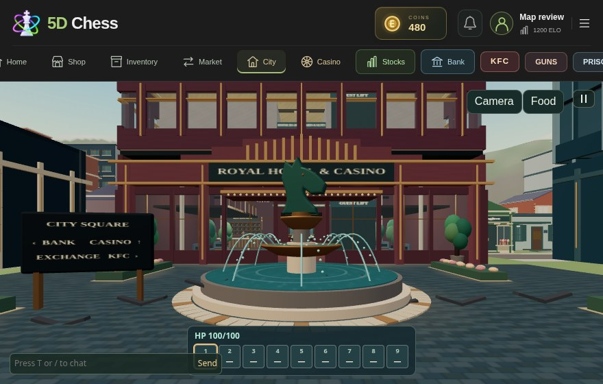
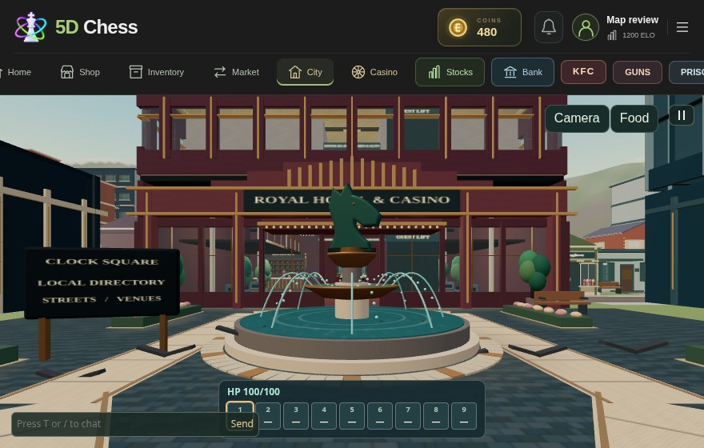
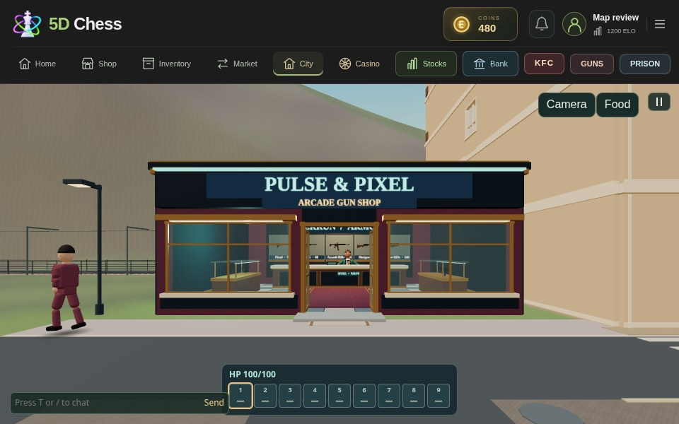
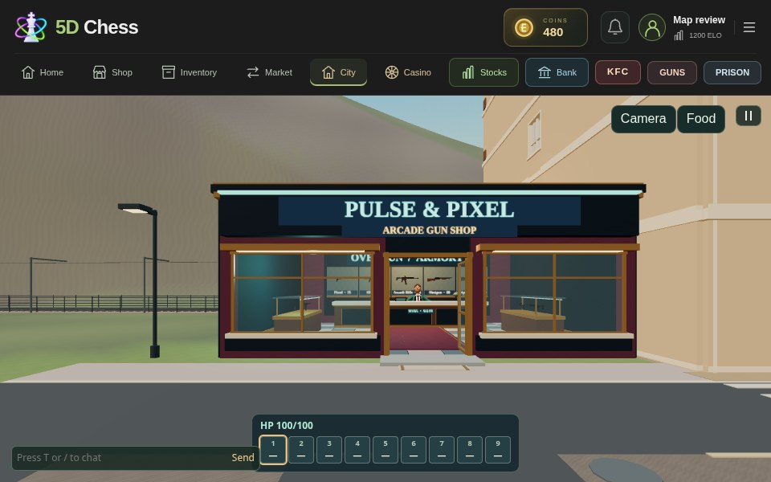
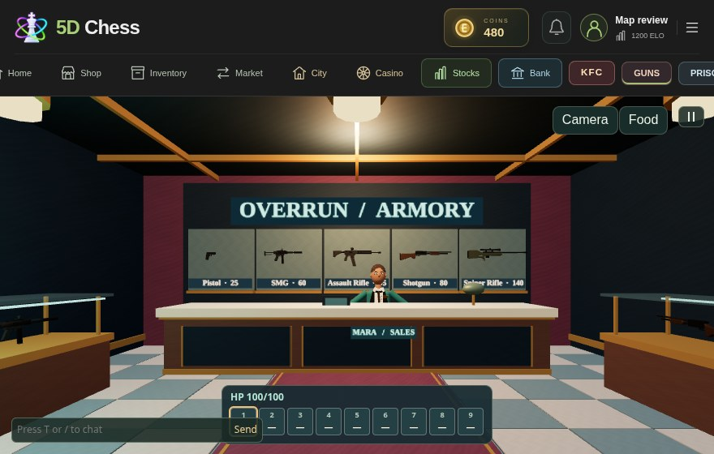
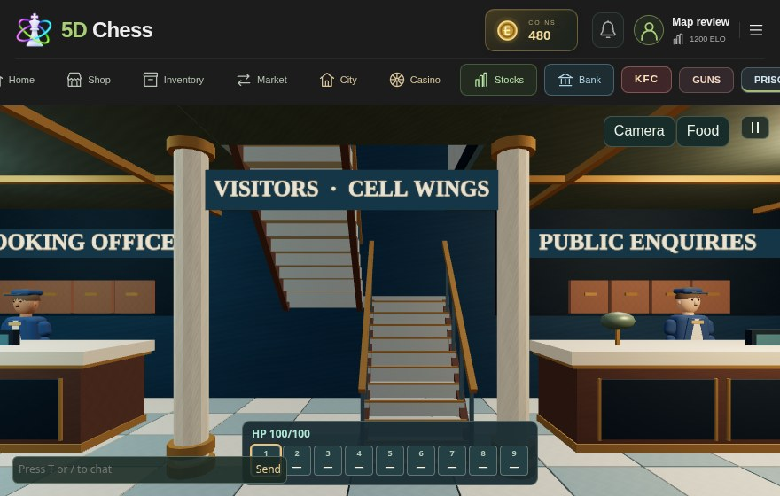

# Editing and shipping Meridian

Use Node 24 and install dependencies with `npm ci`. Run `npm run world:build` to validate the source and write the manifest, the shared and visual JSON sections, and `.meridian/preview.svg`. Open the SVG directly in a browser and zoom in. Red dots mark doors and gold dots mark lamps. Hover a prop or door for its ID. The checked-in overview shows the default layout. [Open the map](review/meridian-build/meridian.svg)

## Edit a block

1. Find the named parcel, street or venue in [the Meridian source](../world/meridian/source.ts). Street endpoints establish the map skeleton in metres. A frontage uses the street ID, distance `along` from endpoint A towards B, the `side` looking in that direction, and perpendicular `setback` from the centreline to the parcel centre. On eastbound Civic Avenue, left is north. Meridian Central uses the extended line past the end of Station Approach.
2. To try the reviewed move, change only `shop.frontage.along` from `6.85` to `7.85`. Rebuild and inspect the preview. The door, signs, shop interior, clerk, counter, collision footprint, pedestrian approach and frontage lamp all belong to this parcel. The released source keeps the value at `6.85`. The casino likewise attaches to its hotel. Interior fixture coordinates use local metres.
3. To reserve a clear space, add a `keepClear` record with a unique ID, an existing anchor, east/south offsets `across` and `along`, and a width and depth. Supported anchors include square, park, landmark and room IDs and `gunshop`. For example, `{id:'armory-door',anchor:'gunshop',across:0,along:5,w:1.4,d:1}` leaves the public approach clear. A reserved area intersecting a building fails validation.
4. Set `overrides.civic.lampStyle` or `overrides.central.treeStyle` for a local finish. `frontageDetails` places a lamp or bench against a named entrance. Change its side or use `doorOffset` for a forecourt. The compiler tries clear positions and reports a parcel-specific error if none fits. A bench creates two seats with approach and stand-up positions. The park directory and street signs use the existing proximity action.
5. Run `npm run build` and `npm test`. The golden version in `tests/meridian-build.test.mjs` deliberately detects layout changes. Review the map and both section hashes before updating it. For an interactive check use `npm run dev:server` with a disposable local data directory and enter **City** from the lobby. The default source preserves the existing house, flat, bench, zone, gallery and cell identities.

## Build contract

Ground-level residential towers use the same frontage coordinates as houses. The Exchange Crown lobby follows the Exchange parcel and sits one storey above the highest trading floor.

The compiler resolves parcels and floor templates, validates lots and entrances, lays sidewalks and crossing ramps, selects street furniture, and bakes the traffic graph and pedestrian preferences. Where an older parcel occupies part of a sidewalk band, a lateral approach meets the next clear section. The tests sample every entry path against all building footprints. The shared section carries the physical data used by Node and the renderer. The visual section adds paving rectangles, inlays and keyed facade finishes. The seed governs fine variation. Door states, traffic, people, seats, custody, purchases and puzzle progress still come from the authoritative city. A route search can account for moving vehicles at play time.

The manifest contains the area ID, schema, SHA-256 release version and two content-addressed sections. Hashes cover the exact serialized JSON bytes. The version covers schema, area and both section descriptors. There are no timestamps in the output. Changing the serialization or section contract requires reviewing the schema and its readers. The build currently ships Meridian.

## Coordinate a release

Build the Node and frontend targets from the same revision with `npm run build`. Keep the release version alongside both packages. The Pi executable embeds the shared map, and the existing frontend build writes the three public assets under `.cloudflare/static/chess/maps/meridian/`. Wrangler serves matching files as Workers Static Assets. The existing Worker continues to serve the pages and JS. The Pi continues to serve the API. The preview server and local Node instance also serve the assets under `/chess/maps/meridian/`.

A cold City entry fetches one manifest and two JSON files. The manifest revalidates. Each section has a full content hash in its filename and a one-year immutable cache lifetime. The client checks byte lengths and SHA-256 before using a section. After authentication and the WebGL 2 check, it checks the Pi version before joining. World writes from browsers carry the version. A stale client receives HTTP 412 before its action executes. A missing or incompatible map displays **Retry** and **Back home**. Legacy programmatic API callers without a browser origin can continue to use the original request format.

Stage both packages before switching traffic. Compare the static manifest version with the authenticated Pi endpoint `GET /api/world/map-version`. For a rolling update, clients reaching different releases can retry once both endpoints agree. Keep the prior matching pair for rollback. A map-only build leaves SQLite untouched. Relocating an occupied residence or custody parcel in a future release also needs a review of saved absolute positions and a migration test.

## Local verification

The default sections measure 620,394 and 38,838 bytes for shared and visual data respectively. Node gzip measured 47,413 and 6,228 bytes. The manifest is 495 bytes. Local Wrangler returned `application/json`, respected the cache headers and returned 304 for matching ETags on all three files. A missing section returned 404. Login and City HTML, legacy venue redirects, and the separate API route were checked locally. Chromium observed zero map requests on the lobby and exactly three on first City entry. A separate altered build moved the shop by one metre, loaded its matching version in Chromium, and accepted a front-door walk and counter interaction at its new location.

The map preview is a plan projection. Artist-authored meshes, fixture animation, terrain shading and dynamic actors remain in the game renderer. Use the in-game captures to judge the street-level result.

| At the same camera position | Baseline or default | Compiled or edited |
| --- | --- | --- |
| Clock Square, looking towards the Royal Hotel |  |  |
| Civic Avenue, single-edit fixture |  |  |
| Armory counter |  |  |
| Precinct front desk |  |  |
